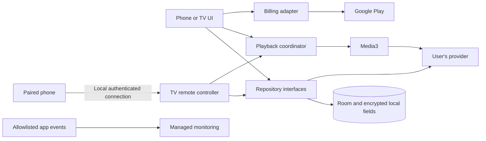

# IPTV Android architecture specification

Date: 24 October 2026  
Status: Working architecture baseline; owner authorized the first Android build. Later phases retain their open decisions.  
Product context: [Product brief](../../../codex/docs/iptv-product-brief.md)

## 1. Purpose and scope

Define how the Android phone, tablet, and TV player fits together before producing implementation tasks. The application plays the user's compatible sources and provides live TV, movies, and series where supplied. Arabic/English, phone-assisted TV setup, and same-network remote control are central requirements.

Working launch scope: source management, categories, search, favourites, EPG, on-demand resume, audio/subtitle selection, parental PIN, pairing, and purchase restoration. Free/paid boundaries remain a commercial decision. Cloud sync, app accounts, recording/downloads, casting, multiview, a web dashboard, and additional playback engines are outside this baseline.

No interviews or external idea discussions are prerequisites. Representative hardware testing remains necessary. This document makes recommendations concrete without claiming that demand, stream compatibility, performance, or publishing readiness has been proven.

## 2. Platform and application structure

Use Kotlin, Compose/Material 3 for phone/tablet, Compose for TV for TV, Media3 ExoPlayer, Room/Paging 3, DataStore, Hilt, Coroutines/Flow, OkHttp/Retrofit, kotlinx.serialization, Coil, and WorkManager. Use Keystore-backed encryption for sensitive fields; validate Tink integration before selecting its persistence mechanism.

Prefer one Android application ID and Play listing with mobile and TV entry activities. Keep UI modules separate without requiring separate application packages. The release application ID follows the future product name and is not invented in this document. Select compatible stable dependency versions and minSdk together during the feasibility stage; Android 9/API 28 is an initial lower-device test candidate, not the approved minimum. Target SDK is a separate release requirement.

The proposed modules below are boundaries to create when needed, not a requirement to scaffold every directory at once:

| Module | Responsibility and permitted dependencies |
| --- | --- |
| `app` | Manifest, mobile/TV entry activities, Hilt wiring, worker registration, release configuration. Composes other modules. |
| `core:model` | IDs, immutable catalogue/playback/entitlement types, and stable error codes. No UI, database, networking, or billing SDK dependencies. |
| `core:designsystem` | Approved Cinema colour/type tokens and original UI illustration shared by device-specific Material adapters. No source, catalogue or playback ownership. |
| `core:data` | JVM source adapters/parsers, protected source encoding, persistence/repository contracts and refresh coordination. Depends on `core:model`; Android Room/Keystore details live in `core:storage`. Search/EPG repositories remain future work. |
| `core:storage` | Current Android Room/Keystore implementation of the data-layer persistence contract. Isolated from JVM-only parsers/loaders so their existing test tasks remain fast and unchanged. Added in the saved-library slice. |
| `core:playback` | One active Media3 player per device, media session, stream resolution through repository interfaces, track selection, resume, and typed playback state. Depends on `core:model` and injected interfaces. |
| `core:remote` | Discovery, pairing/trust storage, encrypted transport, protocol validation, and command routing through injected interfaces. Depends on `core:model`; does not own the player. |
| `core:billing` | Play Billing adapter, purchase processing/restoration, verification adapter, and entitlement state. Depends on `core:model`. |
| `core:observability` | Small telemetry interface with allowlisted events and a managed SDK adapter. Depends on `core:model`. |
| `ui:mobile` / `ui:tv` | Device-specific Compose screens and ViewModels. Consume repository/controllers through interfaces; never access DAOs, provider passwords, or raw billing responses. |

Use repository interfaces and ViewModel state flows. Keep business rules with the capability that owns them; introduce a separate domain module only when shared orchestration warrants it. Hilt composition in `app` resolves dependencies; avoid circular Gradle dependencies and direct dependencies between mobile and TV UI modules.

The diagram describes device-local capabilities; each installation has its own data. Our infrastructure does not proxy video, store provider credentials, or coordinate local remote commands.

## 3. Navigation and application behavior

| Journey | Phone/tablet | TV |
| --- | --- | --- |
| First launch | Language follows device with an explicit switch; add a source or connect to TV. | Language choice, add a source directly, or display phone-setup QR. |
| Source setup | M3U URL, system-picked local file, or Xtream-compatible server/login; optional EPG URL. Enter for this device or explicitly send to paired TV. | Remote-friendly form and phone-assisted entry. No automatic duplication of credentials across devices. |
| Browse | Live, movies, series, favourites, continue watching, search, and source switcher. Adapt tablet panes without changing data behavior. | Equivalent sections with clear focus, readable rows/grids, and remote controls. |
| Details/playback | Programme information, movie details, series/episode list, and touch playback controls. | Equivalent details with D-pad playback controls, Back behavior, and preserved browse focus. |
| Pairing/remote | Discover/scan TV; then D-pad, keyboard, playback controls, and TV catalogue browser. | Approve a named phone, list trusted phones, revoke a phone, and turn remote access off. |
| Settings/purchases | Language, source refresh/removal, parental controls, diagnostics controls, Pro offer, and restore. | Same relevant settings plus pairing management; no touch-only or camera-only requirement. |

Every asynchronous screen has loading, empty, ready, and actionable error states. Retain a usable cached library after a failed refresh and show its age. Remember category, item ID, and scroll/focus anchor on returning from details or playback. Correct RTL does not reverse media-time semantics such as rewind/fast-forward.

## 4. Local data and import model

Room stores structured catalogue and user state; DataStore stores small preferences. Source authentication fields and sensitive URLs/headers use encrypted local persistence with Keystore-protected keys. Raw source or playback URLs can contain credentials, so they are not ordinary debug strings or telemetry dimensions.

Implementation status (2 November): Android `core:storage` uses standard AES-GCM/Keystore envelope protection; Tink was a candidate rather than a dependency requirement. Source-scoped catalogue caches, encrypted friendly names, one active selection, Room Paging/search and favourites are implemented. The local [Continue Watching slice](2026-11-01-continue-watching-design.md) adds schema-4 watch progress independently of replaceable catalogue generations, with bounded encrypted snapshots for watched API episodes. Migrations retain the 1-to-2-to-3-to-4 chain and existing ciphertext/identities. The 0.10.0 capacity slice processes encrypted writes and identity resolution in batches of 250 and returns a lightweight committed session to the production importer; legacy full-catalogue save remains compatible. Import still stages the bounded parsed catalogue before transactional activation; full incremental import, complete episode-list caching, EPG and scheduled refresh remain open. Consult the tracker/live delivery PR for actual verification and delivery state; this does not complete the data architecture.

| Record | Identity and contents |
| --- | --- |
| `Source` | Local UUID, display name/type, encrypted connection reference, active catalogue/guide generation IDs, last successful refresh, and refresh outcome. |
| `Category` | Source-scoped provider key, content kind, label, ordering, and catalogue generation. |
| `ItemIdentity` | Stable local ID and source-scoped provider identity, namespaced by kind (`channel`, `movie`, `series`, `episode`). Survives replaceable catalogue generations. |
| `LibraryItem` | Snapshot keyed by generation and stable item ID; parent series/season information, original label, search representation, metadata, category memberships, and protected playback locator. |
| `UserItemState` | Stable item ID, favourite flag, resume position/duration, completion state, and last watched time. Stored separately from replaceable imports. |
| `GuideChannelMapping` | Source-scoped guide channel key mapped to a channel item, including any explicit user override. |
| `Programme` | Source/guide key, start and end UTC instants, original schedule offset when present, title/description, and guide generation. Indexed for channel and time-window queries. |
| `TrustedPhone` | Device ID/name, hash of issued bearer secret, creation/revocation state; raw secret remains encrypted on the phone. TV identity keys/certificate remain in protected local storage. |
| `RefreshRun` | Source, import kind/generation, progress, completion state, and safe error code. No secrets or raw response bodies. |

Use source-scoped provider IDs where reliable. M3U `tvg-id` helps guide mapping but is not assumed unique per playable item. Ambiguous duplicate channels stay distinct. Do not merge items by normalized title alone or use a credential-bearing stream URL as a public ID. Preserve user state only for confidently matched identities; retain unmatched state as unavailable rather than attach it to a different title.

Import pipeline: stream download/read -> incremental parse -> bounded database batches into a new generation -> validate -> atomically activate that generation -> clean old catalogue rows. Queries/search join the active generation for each source. User state references `ItemIdentity`, not a replaceable snapshot; old-generation cleanup must not cascade into favourites/progress. A failed/cancelled/process-interrupted import leaves the last committed generation active. Apply the same principle independently to EPG. Enforce one refresh per source/import kind and route manual/worker refreshes through the same coordinator.

Disable external XML entities and reject unsupported or malformed inputs safely. Bound decompressed input size, line/field length, entry count, parse duration, and concurrent imports; select documented numerical limits from the large-fixture/device measurements before shipping the importer. Do not require the entire XMLTV file or catalogue in memory.

Treat catalogue M3U files and HLS playback manifests as different inputs. M3U does not reliably describe movie/series hierarchy: expose only what its metadata or an explicit mapping establishes. Xtream-compatible adapters preserve source-provided kinds, series, seasons, and episodes. Do not invent seasons from title guesses.

Search uses Room FTS plus preserved original labels and a separate normalized representation. Start with diacritic/tatweel removal and tested alef variants; validate mixed Arabic/Latin/numeric queries. Potentially lossy letter equivalences are optional matching expansions. Guide dates become UTC instants; honor supplied offsets. A feed with missing/ambiguous offsets requires an explicit source time-zone setting. Device time zone affects display, not stored schedule instants.

WorkManager schedules deferrable refreshes with network constraints and bounded retries; refresh-on-open and manual refresh share the coordinator. User deletion of a source explicitly confirms removal of its credentials, catalogue, favourites, and progress. Refreshing a source never performs that deletion. Reinstallation requires re-adding sources and pairing; purchase restoration is independent. Exclude app-private data and credentials from backup/device transfer for the initial release rather than restore ciphertext without its keys.

## 5. Playback and parental restrictions

`PlaybackCoordinator` is the single owner of local playback commands, whether initiated by touch, TV remote, or paired phone. It resolves a source-scoped item to a short-lived playback request containing the URL, required headers, and known media hints. Media3 receives the request; provider stream addresses do not pass through our servers.

Expose typed state: idle, preparing, playing, buffering, paused, ended, and failed. Classify only observable failures: authentication rejected, resource unavailable, network failure, or unsupported decoding. Avoid claiming that every stall is a provider or Internet fault. Retry transient failures with bounded backoff; do not repeatedly retry invalid credentials.

Preserve VOD resume periodically and on pause/stop; do not offer resume or seeking for live streams unless the stream actually supports them. One stream plays per device in the baseline. Phone browsing and remote commands do not start an additional provider playback session. Audio/subtitle availability is stream/device-dependent. Start with Media3's supported platform decoding; evaluate the FFmpeg audio module only after a demonstrated gap, and evaluate libVLC separately rather than include it by default.

The initial remote server operates while the TV app is visible, including its player. Stop discovery/server when that scope ends or remote access is disabled. The phone shows disconnected and asks the user to reopen our TV app; system-wide wake/control is outside scope. WorkManager is not a remote-server host. Additional background playback behavior requires its own media-service/lifecycle design.

Store a salted PIN verifier, never a plaintext PIN; throttle failed attempts. Enforce blocked category/item access in shared application rules for search, details, playback, and remote commands. Pairing does not bypass parental restrictions. Restricted-setting changes and credential replacement initiated from a phone require explicit TV-side authorization. State clearly that a local PIN is a household convenience, not a guarantee against a device owner modifying app data.

## 6. Phone-to-TV pairing and protocol

Use NSD/mDNS as discovery, never authorization. Support direct QR connection when multicast discovery fails; a QR cannot overcome guest-network client isolation or denied local-network permissions. Ask for camera access only for scanning, offer direct endpoint entry, and handle applicable local-network permission denial without breaking local playback. Keep provider addresses separate from this LAN endpoint.

Proposed primary flow:

1. TV starts an explicit, short-lived pairing session. QR contains protocol version, reachable endpoint, TV TLS certificate fingerprint, and a cryptographically random single-use bootstrap nonce; no provider credentials or long-lived trust token.
2. Phone connects with TLS and validates the fingerprint obtained from the QR. Do not globally disable certificate validation or trust an unauthenticated NSD fingerprint.
3. TV displays the pending phone name and asks for approval. Bootstrap expires after 120 seconds, is consumed once, and limits failed attempts to five before a new session is required.
4. After approval, TV issues a random per-phone secret over the protected connection; TV stores its hash and phone stores it encrypted. Both remember the TV certificate identity. Certificate replacement requires a new trusted pairing.
5. TV can revoke one phone or all phones immediately, closing existing revoked connections. Every new connection authenticates; successful LAN discovery alone grants nothing.

A short-code-only setup needs an authenticated bootstrap mechanism, not merely TLS with certificate checks disabled. Initial manual fallback uses direct endpoint entry and explicit certificate-fingerprint comparison on both screens before TV approval. A more convenient code-only flow is deferred until an established, reviewed pairing mechanism is selected.

Use a versioned JSON WebSocket protocol. Requests carry request IDs; responses report accepted/completed/rejected plus safe codes. Serialize player-changing commands, reject oversized/unknown commands, rate-limit senders, and avoid replaying non-idempotent commands after reconnect. The phone first retrieves current TV state following reconnection.

Initial commands: navigate/select/back, play/pause, switch channel, supported seek, input search text, paginated TV catalogue queries, and play a TV-owned item ID. TV resolves all item IDs and checks current restrictions; do not accept arbitrary stream URLs as playback commands. Browsing the TV catalogue uses the TV's source/item IDs, not IDs from an independently imported phone source. The phone has no implicit favourites/progress sync.

Source setup transfer is a separate, explicitly approved TV action over the same protected channel. By default, credentials entered for TV setup are retained only on the TV and cleared from the phone setup form/session. Editing sources is not an unrestricted remote-control command. Embedded Ktor CIO is the first transport candidate; prove TLS pinning, Android compatibility, server shutdown, and reconnect behavior on hardware before accepting it.

## 7. Purchases and ownership

`EntitlementRepository` supplies device UI/capabilities with free, pending, active-one-time, active-until-expiry, expired/revoked, or unknown state. The billing adapter handles product queries, completed/pending purchases, acknowledgement, restoration, and store reconnects. UI consumes entitlements and localized Play pricing; it does not grant Pro by writing a settings flag or reading Remote Config.

One-time non-consumable and yearly access remain alternatives. Annual auto-renewal and manually topped-up prepaid access are distinct commercial choices. Avoid offering a permanent unlock to someone already entitled to the same benefits without explaining the existing subscription and cancellation path.

Working device model: purchase restoration for this Play app using the purchasing Google account. No custom household licence, arbitrary device allowance, or cross-account purchase transfer is promised. Pairing a paid phone does not make an unpaid TV installation paid; playback rights are checked on the playback device. The eventual free tier must allow whatever pairing/setup behavior the offer promises.

Verification is a decision before paid release: Google recommends secure server verification; a managed purchase service can provide it without our own hosted backend. A client-only one-time design can query and process Play purchases locally but accepts weaker tamper resistance and delayed reconciliation. Never ship Google Play Developer API service-account credentials in the app. Neither monitoring nor local pairing resolves this decision.

Network/query failure yields unknown state with the last-known record retained; it neither grants new access nor proves revocation. A successful store reconciliation updates access. Annual expiry/offline grace requires verified expiry information and a defined policy; device wall-clock changes must not create fresh paid time. Exact cache/grace duration, verification method, price, products, and free/paid feature map remain owner decisions before billing implementation. Refund and pending-purchase paths must be tested for whichever model is selected.

## 8. Monitoring, privacy, and configuration

Implementation update (29 October): the owner selected PostHog for managed analytics, filtered error classes and structured import logs. The current adapter lives in the app module; no custom backend or Firebase SDK is added. See [configuration, privacy filters and verification](../../development/posthog.md). Play Console vitals and the remaining release monitoring work are still future tasks. Candidate events: import outcome/duration/count bucket, playback startup/buffering duration and safe failure class, pairing outcome, and purchase-flow outcome. Use only allowlisted enums/numeric buckets; never send provider credentials/hosts, raw URLs, pairing secrets, titles, search text, or response bodies. Review fatal exception paths as well as custom logging.

Performance Monitoring is optional. Provider URLs can embed credentials in paths, so do not enable automatic provider-network instrumentation unless safe collection/exclusion is demonstrated. Omit the SDK if necessary and use safe app-level measurements. Collection controls, retention, SDK disclosures, and privacy/Data safety statements must match actual release behavior.

Remote Config can disable selected optional features after fetch/activation, with safe bundled defaults and no startup dependency. It cannot guarantee immediate offline revocation and is not an entitlement authority. Keep BigQuery/Looker Studio out of the initial runtime design; consider exports only when existing dashboards are insufficient and cost limits are set. No custom owner dashboard or hosted application backend is required for this baseline.

## 9. Physical-device and fixture verification

This is a test plan, not a claim that hardware is available or tests have passed. Inventory actual device models, RAM, Android version, Play certification, display/audio output, app build, and fixture before each run.

| Device category | Main checks |
| --- | --- |
| Lower-spec Android TV/Google TV device, initially including an Android 9 candidate if available | Memory, import/search, grid focus, channel switching, supported audio/video, and Play restoration. |
| Current supported Android TV/Google TV device | Newer OS/permission behavior, pairing, playback, navigation, and release packaging. |
| Lower-memory Android phone | Streaming parse, process recreation, scanner permissions, playback, and remote connection. |
| Current Android phone | Pairing TLS, local-network permissions, purchase flow, and lifecycle transitions. |
| Tablet | Adaptive layouts, rotation, RTL/mixed text, playback, and keyboard navigation where available. |

Use original/authorized media and synthetic fixtures: catalogues with 1,000/10,000/100,000 items, XMLTV fixtures with 10,000/100,000/500,000 programmes, duplicate/missing IDs, malformed/truncated inputs, Arabic/English mixed labels, and explicit/missing time zones. These are test sizes, not promised product limits.

Required checks:

- Import/cancel/kill/restart at different phases: active generation remains valid, favourites/resume remain attached to the right items, partial generations do not become visible, and repeated refreshes do not accumulate indefinitely.
- Search and page large libraries while playback runs: no crashes/ANRs; record peak heap and p50/p95 interaction/import timings on named hardware before setting release performance budgets.
- Run authorized HLS/DASH/direct-stream fixtures, available audio/subtitle variants, authentication failures, connection loss, source refresh, and at least a 30-minute playback session per representative device class. Record unsupported codecs explicitly.
- Navigate every TV screen with D-pad in Arabic and English; restore focus after details, playback, list changes, and process recreation. Confirm parental restrictions also apply through remote search/play commands.
- Pair, reject, expire, reconnect, change network/IP, revoke, disable permissions, and close/reopen TV app. Confirm unpaired devices cannot control playback or replace sources; certificate mismatch and expired bootstrap fail closed.
- Test source setup transfer, credential storage/backup exclusions, logs/crash reports, and encrypted fields. Confirm phone remote browsing opens no extra stream and transferred sources are not silently saved to the phone.
- Use Play licence testing for pending/completed/cancelled purchases, reinstall/restore, account mismatch, refunds, store disconnection, and annual expiry/renewal if selected. Keep debug entitlements out of release builds.

## 10. Decisions and implementation sequence

| Decision | Recommendation / boundary |
| --- | --- |
| Platforms and stack | Native Android stack above; one app identity and separate device UI. |
| Hosted services | Managed monitoring; no custom application backend or mandatory app account. |
| Payment offer | Owner chooses one-time or yearly, free limits, and device/account terms before billing work. |
| Purchase verification/offline policy | Choose client-only tradeoffs or a managed verifier and define offline behavior before billing work. |
| Remote transport | Start evaluation with Ktor CIO; accept only after hardware/TLS/lifecycle checks. QR is primary pairing. |
| Compatibility floors and resource/performance limits | Select from compatible dependencies and recorded physical-device measurements before release commitments. |
| Product name/application ID | Choose before creating a permanent Play identity; an internal prototype identifier does not reserve the final brand. |

After design review and development authorization, split implementation into independently reviewable plans: (1) source import/playback and compatibility proof, (2) local catalogue/search/EPG and user state, (3) mobile/TV navigation and parental rules, (4) pairing/phone-assisted setup, and (5) selected billing/monitoring/release work. The first proof should exercise a minimal real TV interaction early; do not postpone TV feasibility until after a phone-only build.

This specification itself created no application, dependency installation, external service, account, or publication. At authoring time the workspace contained planning documents and was not a Git repository. Subsequent directory/tool/GitHub setup is tracked in [progress.md](../../../progress.md); use that tracker for the current state.

## 11. Primary references

Official documentation checked on 24 October 2026. Recheck version-dependent requirements when choosing dependencies and preparing a release.

- [Compose for TV](https://developer.android.com/training/tv/playback/compose) and [single app for mobile and TV](https://developer.android.com/training/tv/get-started/create)
- [Media3 supported formats](https://developer.android.com/media/media3/exoplayer/supported-formats) and [FFmpeg audio decoder](https://github.com/androidx/media/blob/release/libraries/decoder_ffmpeg/README.md)
- [Room](https://developer.android.com/training/data-storage/room) and [DataStore](https://developer.android.com/topic/libraries/architecture/datastore)
- [Network service discovery](https://developer.android.com/develop/connectivity/wifi/use-nsd), [local-network protections](https://developer.android.com/privacy-and-security/local-network-permission), and [Ktor server engines](https://ktor.io/docs/server-engines.html)
- [WorkManager scheduling](https://developer.android.com/develop/background-work/background-tasks/persistent) and [background foreground-service restrictions](https://developer.android.com/develop/background-work/services/fgs/restrictions-bg-start)
- [Play billing integration](https://developer.android.com/google/play/billing/integrate), [verification guidance](https://developer.android.com/google/play/billing/security), [one-time products](https://developer.android.com/google/play/billing/one-time-products), and [subscriptions](https://developer.android.com/google/play/billing/subscriptions)
- [Remote Config defaults/activation](https://firebase.google.com/docs/remote-config/loading) and [Firebase BigQuery export/costs](https://support.google.com/firebase/answer/6318765?hl=en)
